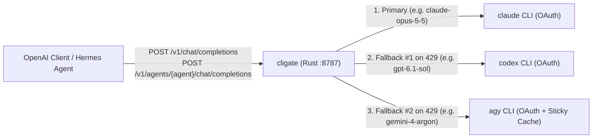

# cligate

**High-performance OpenAI-compatible gateway and per-agent fallback router in Rust powered by your local AI CLI OAuth sessions (`claude`, `codex`, `agy`) — zero API keys, zero external crates.**

`cligate` turns your authenticated coding CLIs (**Claude Code**, **OpenAI Codex CLI**, and **Google Antigravity / AGY**) into a unified local OpenAI API (`/v1/chat/completions` and `/v1/models`) with:

- **Zero API Keys & Zero External Crates**: Written purely against the Rust Standard Library (`std`) with `[dependencies]` completely empty — **zero transitive dependencies, zero CVEs, and a sub-2-second compile time**.
- **Native Model Catalogs (No Confusing Aliases)**: Exposes all native models from each CLI directly in `/v1/models`.
- **Reasoning Effort / Thinking Level Passthrough**: Maps OpenAI `reasoning_effort` (`low`, `medium`, `high`, `xhigh`, `max`) to each CLI's native flag (`--effort` on Claude Code, `-c model_reasoning_effort=...` on Codex, `-<level>` tier on AGY).
- **Automatic Rate-Limit / Quota Fallback (HTTP 429)**: Detects weekly/hourly usage limits on Provider A, places Provider A in cooldown, and transparently reroutes the turn to Provider B → Provider C.
- **Per-Agent Custom Fallback Chains**: Configure distinct primary and fallback model chains per agent (e.g., `coder`: `claude-opus-5-5` → `gpt-6.1-sol` → `gemini-4-argon`).
- **Pre-Warmed Standby Pool & Session-Sticky Delta Prompt Caching**: Keeps warm `agy` stream-json workers and sends only delta messages across multi-turn tool loops.

---

## Architecture



---

## Quick Start

### 1. Prerequisites
Ensure at least one (or all three) of the supported CLIs is installed and logged in via OAuth:
- **Claude Code**: `claude login`
- **Codex CLI**: `codex login`
- **Antigravity CLI**: `agy auth login`

### 2. Install `cligate` (Prebuilt Binary or From Source)

#### Option A: Download Ready-to-Use Binary (GitHub Releases)
```bash
# Linux (ARM64 / aarch64)
curl -fsSL https://github.com/YudaAdiPratama/cligate/releases/latest/download/cligate-linux-arm64 -o ~/.local/bin/cligate
chmod +x ~/.local/bin/cligate

# Linux (x86_64 / amd64)
curl -fsSL https://github.com/YudaAdiPratama/cligate/releases/latest/download/cligate-linux-x86_64 -o ~/.local/bin/cligate
chmod +x ~/.local/bin/cligate

# macOS (Apple Silicon / ARM64)
curl -fsSL https://github.com/YudaAdiPratama/cligate/releases/latest/download/cligate-macos-arm64 -o ~/.local/bin/cligate
chmod +x ~/.local/bin/cligate
```

Then simply run `cligate` to launch the interactive TUI:
```bash
cligate
```

#### Option B: Build from Source (Rust)
```bash
git clone https://github.com/YudaAdiPratama/cligate.git
cd cligate
cargo build --release
install -m 755 target/release/cligate ~/.local/bin/cligate
```

### 3. Start the Gateway Server
```bash
cligate serve --host 127.0.0.1 --port 8787
```

---

## Configuration

### 1. Environment Variables
You can configure `cligate` using environment variables:

| Variable | Default | Description |
| :--- | :--- | :--- |
| `CLIGATE_HOST` | `127.0.0.1` | Bind address for the HTTP server. |
| `CLIGATE_PORT` | `8787` | Listen port for the HTTP server. |
| `CLIGATE_DEFAULT_MODEL` | `gemini-4-argon` | Default model when `model` is omitted in requests. |
| `CLIGATE_ROUTES_PATH` | `./agent_routes.json` | Path to the JSON file storing per-agent fallback chains. |
| `CLIGATE_WORKDIR` | `~/.cache/cligate/workspace` | Isolated working directory used when spawning CLI subprocesses. |
| `CLIGATE_COOLDOWN_SEC` | `900` | Cooldown duration in seconds (default 15 minutes) when a provider hits HTTP 429 / quota limits. |
| `CLIGATE_MAX_PROMPT_BYTES` | `44000` | Maximum prompt payload size in bytes before head/tail context clipping. |
| `CLIGATE_STICKY_TTL_SEC` | `1800` | Idle time-to-live in seconds for cached sticky `agy` sessions. |
| `CLIGATE_MAX_STICKY_SESSIONS` | `6` | Maximum number of concurrent sticky `agy` sessions kept in memory. |
| `CLIGATE_CLAUDE_BIN` | `claude` *(auto-detected)* | Explicit path to the `claude` CLI binary. |
| `CLIGATE_CODEX_BIN` | `codex` *(auto-detected)* | Explicit path to the `codex` CLI binary. |
| `CLIGATE_AGY_BIN` | `agy` *(auto-detected)* | Explicit path to the `agy` CLI binary. |

### 2. Per-Agent Fallback Configuration (`agent_routes.json`)
Copy `agent_routes.example.json` to `agent_routes.json` (or manage it via `cligate agent set`):

```bash
cp agent_routes.example.json agent_routes.json
```

Example `agent_routes.json`:
```json
{
  "agents": {
    "coder": {
      "effort": "high",
      "chain": [
        "claude-opus-5-5",
        "gpt-6.1-sol",
        "gemini-4-argon"
      ]
    },
    "orchestrator": {
      "effort": "medium",
      "chain": [
        "claude-sonnet-5-5",
        "gpt-6.1-sol",
        "gemini-4-argon"
      ]
    },
    "reviewer": {
      "effort": "high",
      "chain": [
        "gpt-6.1-terra",
        "claude-opus-5-5",
        "gemini-4-neon"
      ]
    }
  }
}
```

How to route requests to a specific agent's chain:
1. **Agent-scoped URL**: `http://127.0.0.1:8787/v1/agents/<agent_name>/chat/completions`
2. **HTTP Header**: `X-Agent-Name: <agent_name>`
3. **Bearer Token**: `Authorization: Bearer agent:<agent_name>`
4. **JSON Body Field**: `{"agent": "<agent_name>", ...}` or `{"user": "<agent_name>", ...}`

### 3. Systemd User Service Configuration (Linux)
To run `cligate` persistently in the background via `systemd`:

Create `~/.config/systemd/user/cligate.service`:
```ini
[Unit]
Description=cligate — Rust Multi-Provider CLI-OAuth OpenAI Gateway & Per-Agent Fallback Router
After=network.target

[Service]
Type=simple
WorkingDirectory=%h/cligate
ExecStart=%h/.local/bin/cligate serve
Restart=on-failure
RestartSec=3
Environment=CLIGATE_HOST=127.0.0.1
Environment=CLIGATE_PORT=8787
Environment=CLIGATE_DEFAULT_MODEL=gemini-4-argon
Environment=CLIGATE_WORKDIR=%h/cligate/workspace
Environment=CLIGATE_ROUTES_PATH=%h/cligate/agent_routes.json

[Install]
WantedBy=default.target
```

Enable and start the service:
```bash
systemctl --user daemon-reload
systemctl --user enable --now cligate.service
systemctl --user status cligate.service
```

### 4. Client & Hermes Agent Configuration

#### Hermes Agent (`~/.hermes/config.yaml`)
Add `cligate` under `providers:` in your Hermes `config.yaml`:
```yaml
providers:
  agy:
    name: agy
    base_url: http://127.0.0.1:8787/v1/agents/coder
    default_model: gemini-4-argon
    api_mode: chat_completions
    models:
      gemini-4-neon: {}
      gemini-4-carbon: {}
      gemini-4-argon: {}
      gemini-4-hydrogen: {}
      gemini-3.8-flash: {}
      claude-opus-5-5: {}
      claude-sonnet-5-5: {}
      gpt-6.1-sol: {}
      gpt-6.1-terra: {}
```

Switch models and reasoning effort levels directly in Hermes chat:
```text
/model agy/gemini-4-neon --reasoning xhigh
/model agy/claude-opus-5-5 --reasoning high
/model agy/gpt-6.1-terra --reasoning high
/reasoning max
```

#### OpenAI Python SDK
```python
from openai import OpenAI

client = OpenAI(
    base_url="http://127.0.0.1:8787/v1/agents/coder",
    api_key="oauth",
)

response = client.chat.completions.create(
    model="claude-opus-5-5",
    reasoning_effort="high",
    messages=[{"role": "user", "content": "Explain raft consensus in 3 bullet points."}],
)
print(response.choices[0].message.content)
```

---

## CLI & Interactive TUI Usage

### Launch the Interactive Terminal UI (TUI)
`cligate` includes a built-in full-screen ANSI Terminal User Interface with interactive modal pickers for models, reasoning effort levels, and per-agent fallback chains:

```bash
cligate
cligate --continue
cligate --resume <session_id>
cligate tui --agent coder --effort high
cligate tui --model gemini-4-neon --effort xhigh
```

Inside the TUI:
- `F2` or `/model`: Open interactive **Model & Level Picker** (select from all 36 native `claude`, `codex`, and `agy` models, then immediately choose its reasoning effort level).
- `F3` or `/effort`: Open interactive **Reasoning Effort Level Picker** (`low`, `medium`, `high`, `xhigh`, `max`).
- `F4` or `/agent`: Open interactive **Agent Fallback Chain Picker** (or type `/agent set <name> <m1> <m2> <m3> --effort <level>`).
- `/compact [focus]`: Summarize and compact the conversation history into a concise context summary.
- `/resume`: Open interactive **Session Picker** to resume any saved conversation (or `/resume <id>`).
- `/new`: Start a fresh session while keeping the previous one saved.
- `F5` or `/status`: Display live provider health, cooldown timers, and sticky cache metrics.
- `/reset`: Clear all 429 rate-limit cooldowns.
- `/clear`: Clear conversation transcript.
- `Esc` or `Ctrl+C`: Interrupt active generation; `Ctrl+C` (when idle) or `/quit` exits and prints the session ID for resuming.

### Run a One-Shot Prompt from the Terminal (`cligate ask`)
```bash
cligate ask "Explain lock-free ring buffers in Rust"
cligate ask --agent coder --effort high "Write a minimal token bucket rate limiter"
cligate ask --model gemini-4-neon --effort xhigh "Analyze this algorithm"
```

### List All Native Models & Supported Effort Levels
```bash
cligate models
cligate models claude
cligate models codex
cligate models agy
```

### Manage Per-Agent Fallback Chains
```bash
cligate agent status
cligate agent set coder claude-opus-5-5 gpt-6.1-sol gemini-4-argon --effort high
cligate agent set orchestrator claude-sonnet-5-5 gpt-6.1-sol gemini-4-argon --effort medium
```

### Inspect Live Router Status & Reset Cooldowns
```bash
cligate status
cligate reset
cligate reset claude
```

---

## OpenAI API Endpoints

| Endpoint | Method | Description |
| :--- | :--- | :--- |
| `/v1/models` | `GET` | List all native models across `claude`, `codex`, and `agy` (optional `?provider=claude\|codex\|agy`). |
| `/v1/chat/completions` | `POST` | Standard OpenAI Chat Completions (`stream: true/false`, `tools`, `reasoning_effort`). |
| `/v1/agents/<agent>/chat/completions` | `POST` | Agent-scoped Chat Completions using `<agent>`'s custom fallback chain. |
| `/v1/router/status` | `GET` | Live health, provider cooldowns, recent fallback events, and sticky cache metrics. |
| `/v1/router/agents` | `GET` / `POST` | Inspect or dynamically update per-agent fallback chains without restarting. |
| `/v1/router/reset` | `POST` | Clear cooldown timers (`{"provider": "claude"}` or `{}` for all). |

---

## License

MIT License — see [LICENSE](LICENSE).
